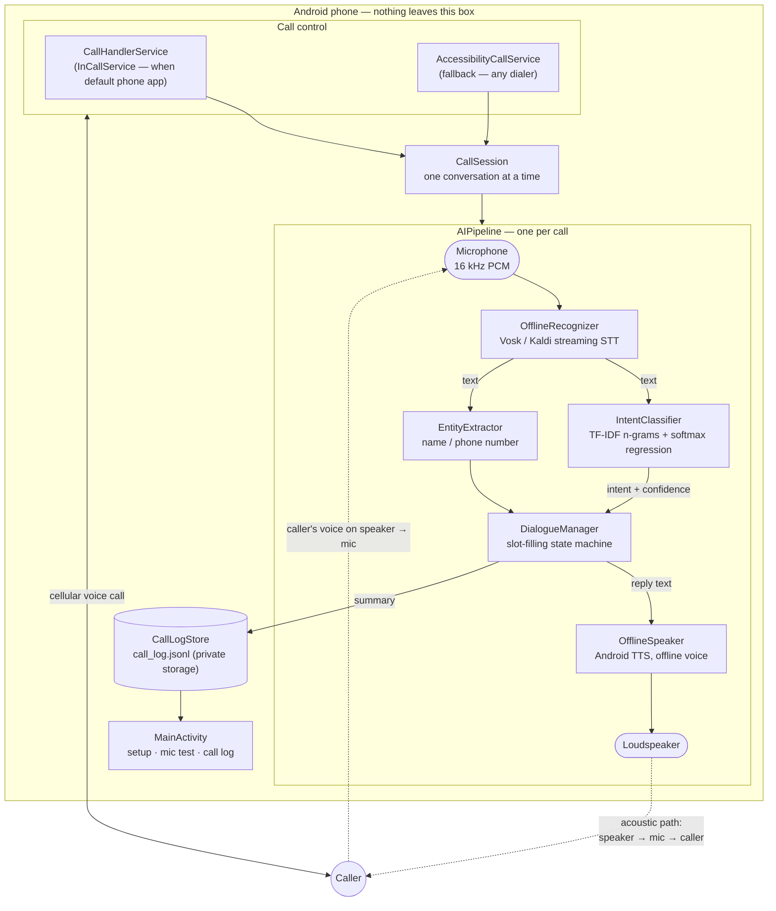
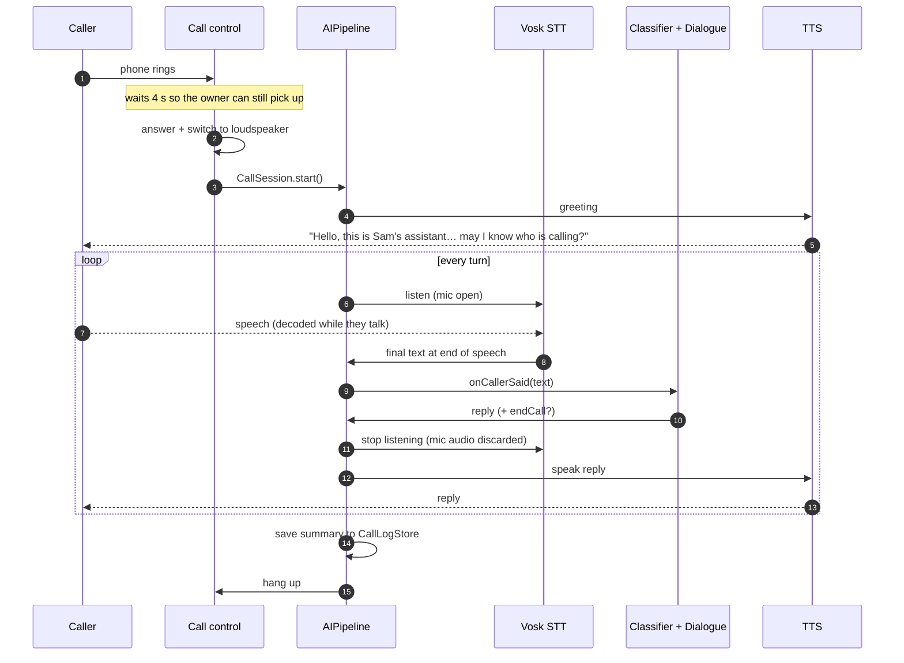
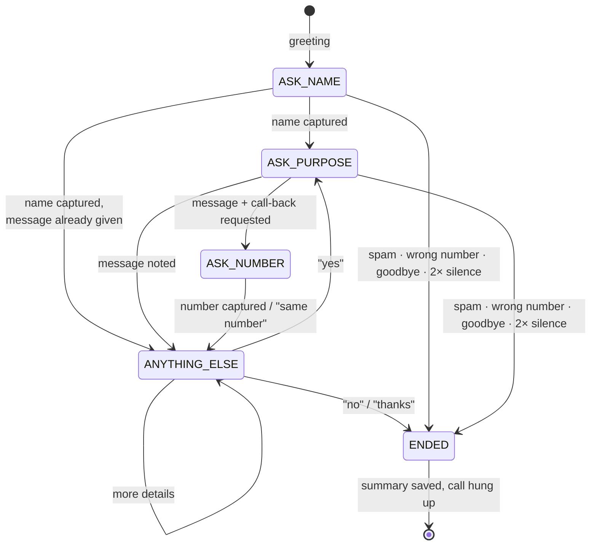

# CallAgent — an offline, on-device call-answering agent for Android


> **🏷️ Completely generated using [Claude Code](https://claude.com/claude-code).**
> Every line of code, the training data, the tests and this document were written by Claude Code.

CallAgent picks up your phone calls when you can't, talks to the caller, finds out **who**
is calling and **why**, takes a message, and hangs up — with **no cloud API, no API key and no
internet connection**. The app does not even request the `INTERNET` permission.

---

## Why this version exists

The first version sent the caller's speech to a cloud recogniser and then to the Gemini API.
That failed in practice for two reasons:

| Problem with the cloud version | How this version solves it |
|---|---|
| No signal / no data ⇒ the agent was dead | Every stage runs on the phone. Airplane-mode Wi-Fi-off works. |
| Speech → text → HTTPS → LLM → text → speech added seconds of lag per turn | Streaming on-device recognition + a classifier that answers in **microseconds** |
| An API key was shipped inside the app | There is no key. There is no network code. |

---

## System architecture



### Components

| Layer | Class | Technology | Job |
|---|---|---|---|
| Call control | [`CallHandlerService`](app/src/main/java/com/example/callagent/CallHandlerService.kt) | `InCallService` | Answers, routes to speaker, hangs up via Telecom (when CallAgent is the default phone app) |
| Call control | [`AccessibilityCallService`](app/src/main/java/com/example/callagent/AccessibilityCallService.kt) | `AccessibilityService` + `TelecomManager` | Answers when another dialer is default; also what allows microphone capture during a call |
| Orchestration | [`CallSession`](app/src/main/java/com/example/callagent/CallSession.kt), [`AIPipeline`](app/src/main/java/com/example/callagent/AIPipeline.kt) | Kotlin | Wires ears → brain → mouth, half-duplex turn taking |
| Ears | [`OfflineRecognizer`](app/src/main/java/com/example/callagent/speech/OfflineRecognizer.kt), [`SpeechModel`](app/src/main/java/com/example/callagent/speech/SpeechModel.kt) | [Vosk](https://alphacephei.com/vosk/) 0.3.75, model `vosk-model-small-en-in-0.4` | Streaming speech-to-text with built-in end-of-speech detection |
| Brain | [`IntentClassifier`](app/src/main/java/com/example/callagent/nlu/IntentClassifier.kt), [`TextFeatures`](app/src/main/java/com/example/callagent/nlu/TextFeatures.kt) | Hand-written ML, pure Kotlin | Classifies what the caller wants (16 intents) |
| Brain | [`EntityExtractor`](app/src/main/java/com/example/callagent/nlu/EntityExtractor.kt) | Rules | Pulls out the caller's name and a spoken phone number |
| Brain | [`DialogueManager`](app/src/main/java/com/example/callagent/dialogue/DialogueManager.kt) | State machine | Decides what to say next and when to end the call |
| Mouth | [`OfflineSpeaker`](app/src/main/java/com/example/callagent/speech/OfflineSpeaker.kt) | Android `TextToSpeech`, pinned to an offline voice | Speaks the reply |
| Storage | [`CallLogStore`](app/src/main/java/com/example/callagent/CallLogStore.kt) | JSON-lines file in app-private storage | Who called, why, and the transcript |

---

## What happens during a call



The conversation is **half-duplex**: while the agent is speaking, microphone audio is
discarded so the agent never transcribes its own voice.

---

## The machine-learning model

The "brain" is deliberately *not* a large language model. A call-screening assistant has a
small, well-defined job, and a small model does it instantly and predictably on any phone.

**Pipeline** ([`IntentClassifier.kt`](app/src/main/java/com/example/callagent/nlu/IntentClassifier.kt), ~150 lines, no libraries):

1. **Tokenise** — lower-case words (this is exactly what the recogniser outputs).
2. **Features** — word unigrams, word bigrams and **character trigrams**. The character
   trigrams are what make it robust to recognition errors: `"urgently"`, `"couriers"` or a
   half-heard word still share most trigrams with the word seen in training.
3. **Weighting** — sub-linear TF × IDF, L2-normalised sparse vectors.
4. **Model** — multinomial logistic regression (softmax), trained with SGD on cross-entropy
   loss with L2 regularisation and a decaying learning rate. Fixed seed ⇒ reproducible.
5. **Decision** — arg-max class with its probability; below the confidence threshold the
   utterance is treated as free-form message content rather than a command.

**Training data** — [`app/src/main/assets/intents.txt`](app/src/main/assets/intents.txt):
343 utterances across 16 intents (`greeting`, `ask_for_owner`, `leave_message`,
`callback_request`, `urgent`, `who_are_you`, `sales_spam`, `delivery`, `inform`, `give_name`,
`affirm`, `deny`, `repeat`, `thanks`, `goodbye`, `wrong_number`).

**Training happens on the phone**, at app start, in a background thread. There is no Python
toolchain and no model file to keep in sync: edit `intents.txt`, rebuild, done.

**Measured** by the unit tests in this repo (desktop JVM; phones are slower but the same order of magnitude):

| Metric | Result |
|---|---|
| Training-set accuracy | 100 % (343 / 343) |
| 5-fold cross-validation accuracy | 84.3 % |
| Inference time | ≈ 50 µs per utterance |

### Dialogue state machine



Handled in every state: *"can you repeat that?"*, *"am I talking to a robot?"*,
*"is he there?"*, sales/scam calls (politely ended and tagged `spam`), delivery agents
(told to leave the parcel), wrong numbers, urgency flags and call-back requests.

Example of what ends up in the call log:

```
URGENT - Priya [personal]
Message: it is very urgent. please ask him to call me back
Wants a call back on 9822012345
```

---

## Build and install

Requirements: Android Studio (or JDK 17+ and the Android SDK), a phone running Android 8.0+.

```bash
git clone <your-repo-url>
```

```bash
./gradlew assembleDebug
```

The **first build** downloads the speech model (~37 MB) into
`app/src/main/assets/model-en-in/` — this is the only time the internet is used, and it is
your build machine that uses it, not the phone. The model is then packed inside the APK.
(The model is git-ignored so the repository stays small.)

Different accent or language? Pick any [Vosk small model](https://alphacephei.com/vosk/models):

```bash
./gradlew assembleDebug -PvoskModel=vosk-model-small-en-us-0.15
```

Run the tests (they train the real model and run whole conversations through it):

```bash
./gradlew testDebugUnitTest
```

## Set up on the phone

1. Open **CallAgent** and wait until *Speech model: ready* (first launch unpacks the model — a few seconds, once).
2. Tap **1. Grant permissions** (microphone, answer calls, phone state).
3. Tap **2. Enable accessibility service** and switch on *CallAgent*.
4. Enter your name — the agent introduces itself as "*your name*'s assistant".
5. Tap **Test agent with microphone** and talk to it. This runs the *entire* pipeline with no phone call, so you can check recognition and replies in airplane mode.
6. Switch on **Auto-answer incoming calls**. It is **off by default**.

Make sure an offline English voice is installed: *Settings → System → Languages → Text-to-speech
output → (engine settings) → Install voice data*. Most phones ship with one.

---

## Honest limitations

- **Real calls have not been tested on a physical device by the author of this code.** The
  project compiles, lint is clean, and the ML and dialogue logic are covered by 17 passing
  unit tests, but call audio behaviour differs between phone makers and must be verified on
  your handset. Use the in-app microphone test first.
- **Audio goes through the loudspeaker.** Android does not let third-party apps read or write
  the call audio stream directly, so the agent hears the caller through the speaker →
  microphone path and the caller hears the agent the same way. The phone will talk out loud
  while it handles a call, a noisy room hurts recognition, and on some phones the call's
  echo canceller may reduce how well the caller hears the agent.
- **In-call microphone access depends on the accessibility service** being enabled
  (Android 10+ silences ordinary apps' microphones during calls otherwise). Some
  manufacturers restrict this further.
- **Default-phone-app mode has no in-call screen.** If you make CallAgent the default phone
  app, it handles answering reliably, but it does not provide a dialer UI of its own. The
  accessibility path (steps above) keeps your normal dialer and is the recommended setup.
- **It is a message-taker, not a chatbot.** It understands the 16 intents above; anything else
  is written down verbatim as the message. Extend `intents.txt` and `DialogueManager` to teach it more.
- **English only** out of the box (Indian-English acoustic model). The small Vosk model
  trades accuracy for size and speed.
- **Tell your callers.** Recording/transcribing calls is regulated in many places; the agent
  announces itself as an assistant, and transcripts never leave the device, but check your local law.

---

## Project layout

```
app/src/main/
├── assets/
│   ├── intents.txt                 # training data for the intent classifier
│   └── model-en-in/                # Vosk model (downloaded at build time, git-ignored)
├── java/com/example/callagent/
│   ├── CallAgentApp.kt             # warms both models at process start
│   ├── MainActivity.kt             # setup, microphone test, call log
│   ├── CallHandlerService.kt       # call control: default-phone-app path
│   ├── AccessibilityCallService.kt # call control: accessibility path
│   ├── CallSession.kt              # single-conversation guard
│   ├── AIPipeline.kt               # STT → NLU → dialogue → TTS loop
│   ├── AgentBrain.kt               # trains + caches the classifier
│   ├── CallLogStore.kt · Settings.kt
│   ├── speech/                     # SpeechModel, OfflineRecognizer, OfflineSpeaker
│   ├── nlu/                        # TextFeatures, IntentClassifier, IntentDataset, EntityExtractor
│   └── dialogue/                   # DialogueManager
└── AndroidManifest.xml             # note: no INTERNET permission
app/src/test/                       # classifier accuracy + full-conversation tests
```

## Credits

- Speech recognition: [Vosk](https://github.com/alphacep/vosk-api) and the
  `vosk-model-small-en-in-0.4` model (Apache 2.0).
- Everything else: **completely generated using [Claude Code](https://claude.com/claude-code).**
